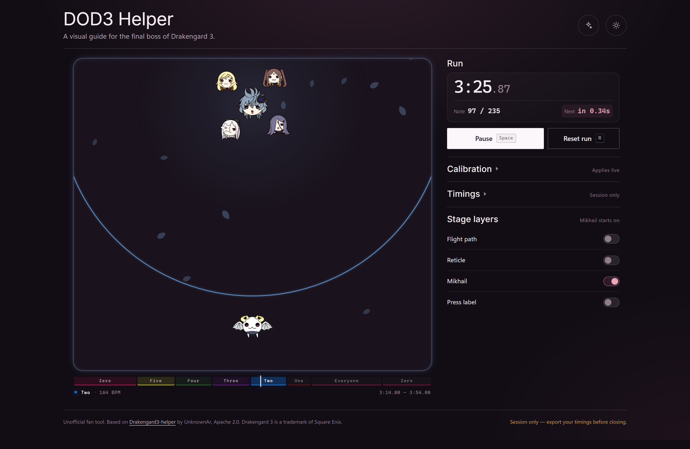
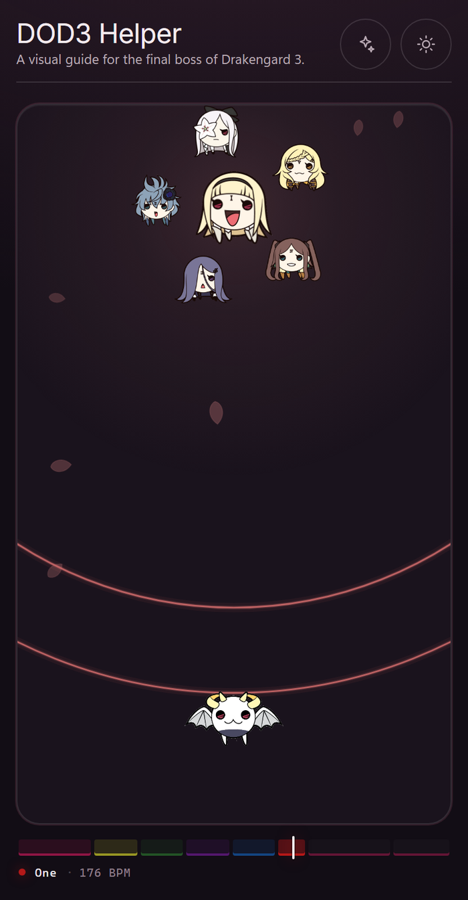

# DOD3 Helper

A visual guide for the final boss of *Drakengard 3*. A ring closes in on the beat, so you know exactly when to press.

**[Open the helper →](https://dieg-go.github.io/dod3-helper-web/)**

## What you get

- **A ring for every note.** Each one starts at the top of the stage and closes on the target at the moment the note is due. The colour tells you which movement you're in.
- **The Intoners keep you company.** Every movement brings another sister on stage — Zero alone, then Five, Four, Three, Two and One, everyone together in VII, and Zero alone again for the finale.
- **Your place in the run**, in one card: elapsed time, which note you're on, and a countdown to the next one.
- **A score map** of the eight movements under the stage, labelled with whoever is on stage at the time, with a live playhead.
- **A stage that breathes with the song**, lit by the current movement, with Mikhail bobbing along to the beat.

## Getting started

1. Open the helper on whatever screen you'll have beside you — a phone is fine.
2. Press **Space** at the same moment you land the first note in the game. That first note is the helper's zero, so start the clock on the note, not on the song.
3. Play along: when a ring reaches the target, that's your press.
4. Press **Space** again to pause whenever you need a breather, or **R** to stop and start over.

The score map under the stage is also a scrubber. Click or drag anywhere on it to jump to that part of the song — handy for drilling one section without playing the whole fight.

## Controls

| Key | What it does |
| --- | --- |
| `Space` | Start, pause, resume — or start over from the end |
| `R` | Stop and go back to ready |
| `←` / `→` | Shift the last note 50 ms later / earlier |
| `Ctrl` + `←` / `→` | Shift the next note 50 ms later / earlier |
| `Shift` + `←` / `→` | Shift every note 50 ms later / earlier |
| `Ctrl` + `↑` / `↓` | Nudge the clock 50 ms earlier / later |
| `↑` / `↓` held | Play the clock slower / faster while held |
| `Y` | Skip the next note |
| `Ctrl` + `Z` | Undo a skip |
| `?` | Show the controls dialog |

On macOS, `Cmd` works wherever `Ctrl` is listed. Most actions also have an on-screen button, including hold-to-slow and hold-to-fast.

## Calibrating

If the rings feel a little early or late compared with the game, you don't need to redo anything — nudge as you play, 50 ms at a time:

- Off on one note? Use `←` / `→` for the last note, or `Ctrl` + `←` / `→` for the next one.
- Off by the same amount everywhere? Use `Shift` + `←` / `→` to move the whole sequence, or `Ctrl` + `↑` / `↓` to move the clock itself.
- Fighting a laggy machine? Hold `↑` to slow the clock or `↓` to speed it up.

## Your own timings

The built-in sequence is the original final-boss timing map, but you can load your own: open **Timings** and import a file with one millisecond value per line. Whatever you import or nudge is saved in this browser, so it's waiting for you next time — **Export** writes a copy you can keep or share, and **Reset** goes back to the built-in sequence.

## On a phone

The stage and score map take the whole screen, and the controls sit just below them.

## Credits

An unofficial fan tool. The timing data and flower artwork come from [Drakengard3-helper](https://github.com/UnknownAr/Drakengard3-helper) by UnknownAr, under the Apache 2.0 license. The license text is in [LICENSE](LICENSE).

*Drakengard 3* is a trademark of Square Enix. This project is not affiliated with or endorsed by Square Enix.
